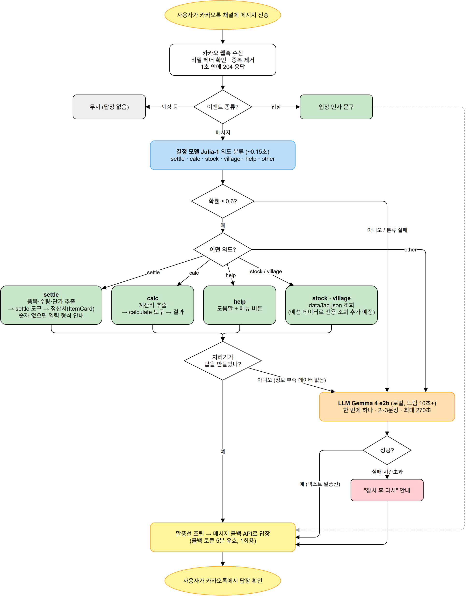

# 메시지 처리 흐름

사용자가 카카오톡 채널에 메시지를 보낸 뒤 답장이 나가기까지의 흐름입니다.
그림: [flow.drawio](flow.drawio) (PNG: [flow.png](flow.png)). 동작 로직이 바뀌면 이 문서와 그림을 함께 고칩니다.

## 1. 수신
1. 카카오가 웹훅으로 이벤트를 보냅니다.
2. 비밀 헤더(`X-Bot-Secret`)가 다르면 401로 거부하고 끝냅니다.
3. 같은 메시지가 다시 오면 무시합니다.
4. **1초 안에 204로 응답**합니다. 카카오 규칙이며, 이후 처리는 백그라운드에서 합니다.

## 2. 이벤트 종류
| 이벤트 | 처리 |
|---|---|
| 입장 (ENTRANCE, CHAT_JOIN) | 인사 문구 |
| 메시지 (MESSAGE_CREATE) | 3단계로 |
| 그 밖 (LEAVE 등) | 무시 |

메시지 앞에 붙은 `@봇이름` 멘션은 지웁니다.

## 3. 의도 분류: 결정 모델 Julia-1
- 모든 메시지는 먼저 **Julia-1**이 의도를 고릅니다. llama.cpp `/v1/systemone`을 쓰며, 중앙값 약 0.15초 걸립니다.
- 선택지: `settle`(정산), `calc`(계산식), `stock`(재고·출하), `village`(마을 정보), `help`(인사·사용법), `other`(그 밖)
- 고른 의도의 확률이 **0.6 미만**이거나 분류 서버가 응답하지 않으면 5단계(LLM)로 보냅니다.
- 의도 설명 문구는 `bot/router.py`의 `INTENTS`에 있습니다. 바꾸면 `bot/bench_decide.py`로 정확도를 다시 재야 합니다. 지금은 21문항 중 13개를 맞힙니다.

## 4. 의도별 처리기 (코드로 즉답)
| 의도 | 처리 | 답장 |
|---|---|---|
| settle | 정규식으로 품목·수량·단가·수수료를 뽑아 `tools.settle`로 계산 | 정산서(ItemCard). 숫자가 없으면 입력 형식 안내 |
| calc | 계산식을 뽑아 `tools.calculate`로 계산 | 계산 결과 텍스트 |
| help | 고정 문구 | 도움말 + 메뉴 버튼 |
| stock, village | `data/faq.json` 키워드 조회 (예선 데이터로 전용 조회 추가 예정) | 텍스트 |

처리기가 답을 만들지 못하면(정보 부족, 데이터 없음) 5단계로 보냅니다.
**금액·수량 계산은 반드시 코드가 합니다.** LLM은 계산을 자주 틀립니다(243,000원을 1,560,000원으로 답한 사례가 있습니다).

## 5. LLM: Gemma 4 e2b (로컬)
- `other` 의도이거나 앞 단계에서 넘어온 메시지만 처리합니다.
- CPU에서 돌기 때문에 한 번에 하나씩, 2~3문장(최대 120토큰)으로 답합니다. 10초 넘게 걸립니다.
- 콜백 토큰 만료(5분)를 고려해 270초 안에 끝나지 않으면 "잠시 후 다시" 안내를 보냅니다.

## 6. 답장
- 말풍선을 조립해 **메시지 콜백 API**(`kapi.kakao.com/v1/bot/callback`)로 보냅니다.
- 콜백 토큰은 5분 동안 유효하고 한 번만 쓸 수 있습니다.
- 한 응답에 말풍선은 최대 3개, 추천 버튼(퀵리플라이)은 최대 10개입니다.

## 응답 시간 목표와 현재
| 경로 | 목표 | 현재 |
|---|---|---|
| 처리기 즉답 (3→4단계) | 중앙값 2초, 최대 5초 | 약 0.2초 |
| LLM (5단계) | 같음 | 10초 이상, 목표 미달 |
